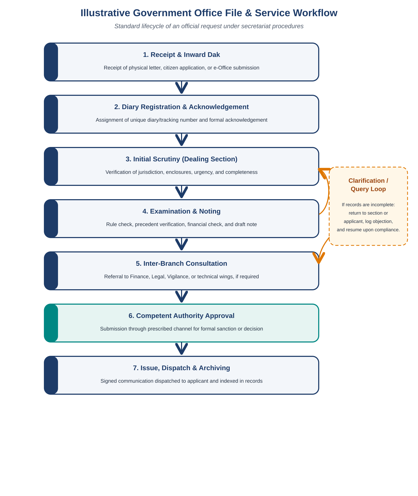

# Government Systems & Procedures

> An India-focused academic starter project on government organization, administrative workflow, public finance, schemes, and inter-departmental coordination.

[](#scope-and-assumptions) [](#disclaimer)

## Project at a glance

This project introduces core features of public administration in India. It uses the Union Government as a general reference point and highlights where state- and department-specific rules must be verified. It is intended for internship preparation and academic study—not as authoritative legal, financial, or procedural advice.

### Illustrative office workflow

The diagram below shows a general file/service workflow. Actual processes vary by department and may be handled through digital systems.



[View the flowchart](images/Government-Administrative-Process-Flowchart.svg)

## Project objectives

1. Understand government organizational structure and hierarchy.
2. Learn administrative procedures and protocols followed in government offices.
3. Study government Acts, rules, and regulations relevant to a department.
4. Understand budgeting processes and public financial management.
5. Learn about government schemes and programs relevant to a ministry.
6. Understand inter-departmental coordination and communication.

## Key themes

- **Organization:** constitutional authorities, political executive, ministries, departments, attached and subordinate offices, and field formations.
- **Office procedure:** receipt and registration, examination, consultation, approval, issue, dispatch, and record retention.
- **Public finance:** budget authorization, delegated financial powers, procurement, accounting, internal controls, audit, and legislative oversight.
- **Scheme delivery:** eligibility, approved guidelines, budget provision, implementation agencies, monitoring, grievance redressal, and evaluation.
- **Coordination:** clear ownership, written references, consultation timelines, shared data, review meetings, and documented decisions.

## Repository contents

```text
.
├── README.md
├── Main-Report.md                         # Editable report draft
├── docs/
│   └── references.md                      # Starting points for official sources
└── images/
    └── Government-Administrative-Process-Flowchart.svg
```

## How to use

1. Read the [report draft](Main-Report.md).
2. Review the [office workflow diagram](images/Government-Administrative-Process-Flowchart.svg).
3. Consult [references](docs/references.md) and verify current rules against official publications.
4. Replace generic examples with the ministry or department, state, applicable Acts, schemes, and budget documents relevant to your assignment.

## Suggested department-specific additions

- Ministry/department name and administrative hierarchy.
- Department-specific Acts, rules, manuals, and latest government orders or circulars.
- Current flagship schemes, eligibility, benefits, implementing agency, and official portal.
- Latest Union/State budget demand for grants or departmental budget.
- A public example of an inter-departmental file or service-delivery workflow. Do not upload confidential records.

## Scope and assumptions

This is a general India-focused study. Because no specific ministry, department, or state was supplied, it uses the Union Government as its primary example and points out where local detail is needed. Illustrations are not substitutes for current department orders, state rules, official scheme guidelines, or professional advice.

## Disclaimer

Prepared for learning and academic purposes. Government rules, schemes, organizational structures, and financial limits may change. Always verify current provisions from official government publications before relying on them.
